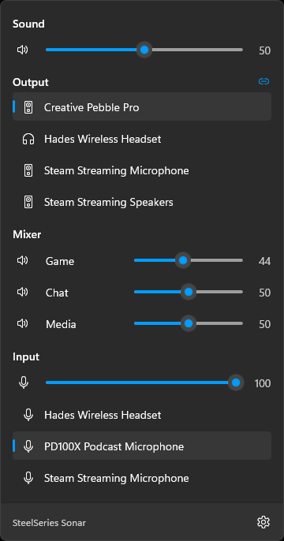
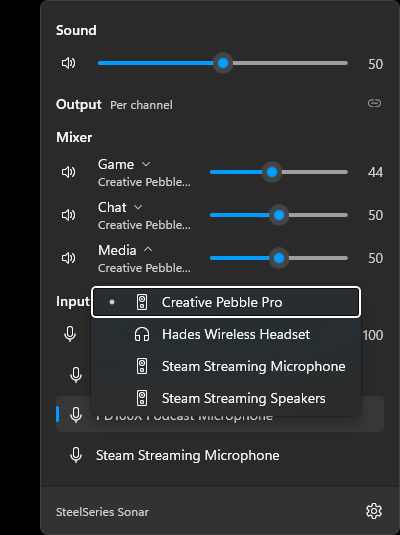

<p align="center">
  
</p>

<h1 align="center">Sonar Flyout</h1>

<p align="center">
  A native Windows 11 tray mixer for SteelSeries Sonar.<br/>
  Change channel volumes and outputs in one click, without opening SteelSeries GG.
</p>

<p align="center">
  <a href="https://github.com/rkzofficial/SonarFlyout/releases/latest"></a>
  <a href="https://github.com/rkzofficial/SonarFlyout/actions/workflows/ci.yml"></a>
  
  <a href="LICENSE"></a>
</p>

<p align="center">
  
  &nbsp;&nbsp;
  
</p>

## Features

- **One click from the taskbar.** A Fluent flyout that looks and behaves like Windows' own volume panel.
- **Every Sonar channel.** Master, Game, Chat, Media, Aux and Mic sliders with mute, kept in sync with Sonar as you or your hotkeys change them.
- **Switch outputs instantly.** Pick headphones, speakers or anything else for all channels at once.
- **Per-channel routing.** Unlink outputs to send each channel to its own device, exactly like Sonar's link toggle.
- **Microphone input.** Choose the device Sonar uses for your mic.
- **Native and light.** WinUI 3, compiled ahead of time, no background services. The tray icon mirrors Sonar's master volume.
- **Follows Windows.** Light and dark theme, 13 languages, screen readers, keyboard, and an optional "Start with Windows".

## Requirements

- Windows 11
- [SteelSeries GG](https://steelseries.com/gg) with Sonar enabled, in **Classic** mode

## Install

**Microsoft Store:** coming soon.

**From source:** see [Building](#building).

## Usage

| Action | What it does |
| --- | --- |
| Click the tray icon | Open or close the mixer |
| Scroll over the tray icon | Raise or lower master volume |
| Click a device under **Output** | Send every channel to that device |
| Click the link icon next to **Output** | Switch between one shared output and per-channel outputs |
| Click a channel name (per-channel mode) | Choose that channel's device |
| Click a speaker or mic icon | Mute or unmute |
| Right-click the tray icon | Open SteelSeries GG, Start with Windows, Exit |

Tip: drag the icon from the hidden-icons (^) area onto the taskbar so it is always one click away.

## How it works

SteelSeries GG runs a local web server for Sonar. Sonar Flyout finds its address from GG's own configuration on your PC and talks to it over `127.0.0.1` only, using the same calls the GG app makes. Nothing leaves your computer. The API is not documented by SteelSeries, so a GG update can change it; if something breaks after an update, please [open an issue](https://github.com/rkzofficial/SonarFlyout/issues).

## Building

Prerequisites:

- Windows 11 with [Developer Mode](https://learn.microsoft.com/windows/apps/get-started/enable-your-device-for-development) on
- [.NET 10 SDK](https://dotnet.microsoft.com/download)
- Visual Studio 2022 or later (or Build Tools) with **Desktop development with C++**, needed for Native AOT
- Windows SDK 10.0.26100

Build, package and install a local copy:

```powershell
.\tools\install-dev.ps1
```

That builds the MSIX, registers it from `AppPackages\layout` and starts the app.

Other scripts in `tools\`:

| Script | Purpose |
| --- | --- |
| `make-assets.ps1` | Regenerates the tray icons and app logos in `Assets\` |
| `translations.py` | Regenerates every `Strings\<language>\Resources.resw` from the English file |
| `make-store-art.ps1` | Regenerates the Microsoft Store images in `store\images\` |

## Translations

Sonar Flyout ships in English, German, French, Spanish, Italian, Brazilian Portuguese, Russian, Polish, Turkish, Japanese, Korean, and Simplified and Traditional Chinese. Corrections from native speakers are very welcome: edit `tools/translations.py` (or the `.resw` file directly) and open a pull request. To add a language, add it to that script and run it.

## Releasing

Pushing a version tag builds the app and submits it to the Microsoft Store. See [docs/RELEASING.md](docs/RELEASING.md).

## Privacy

Sonar Flyout collects no data. See [PRIVACY.md](PRIVACY.md).

## Disclaimer

Sonar Flyout is an independent project. It is **not affiliated with, endorsed by, or sponsored by SteelSeries**. SteelSeries, SteelSeries GG and SteelSeries Sonar are trademarks of SteelSeries ApS.

## License

[MIT](LICENSE)
